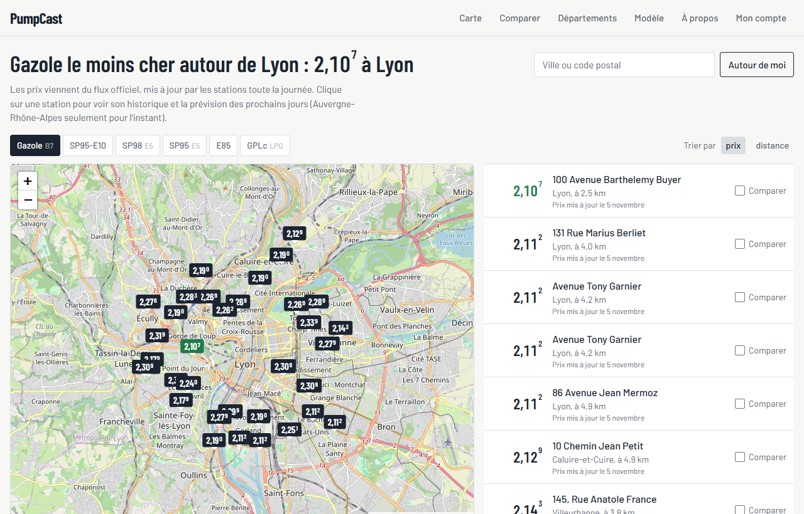
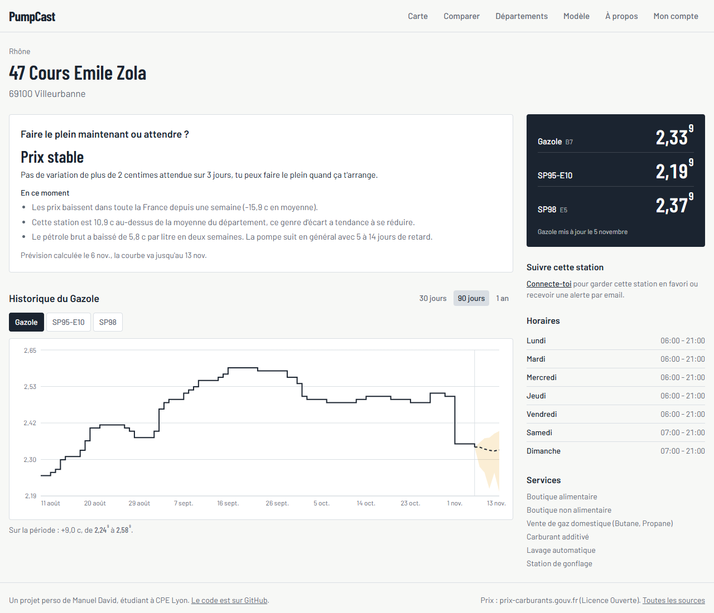
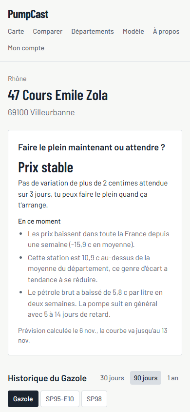
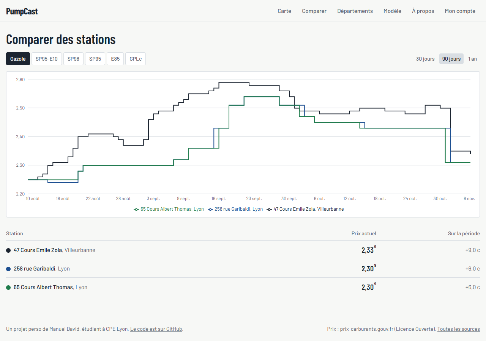
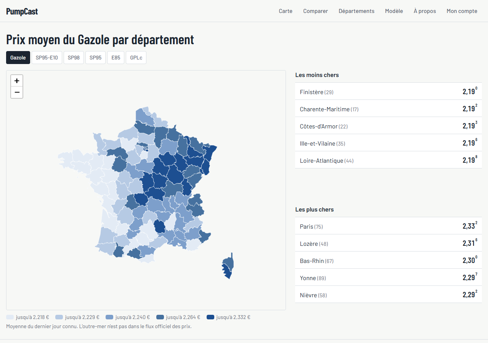
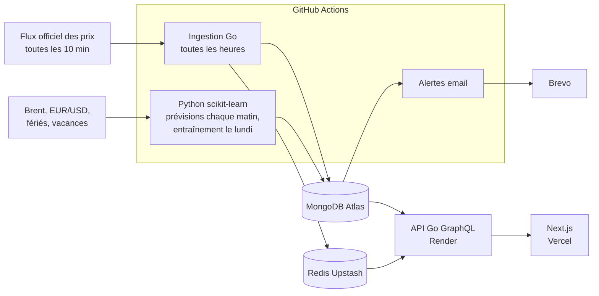
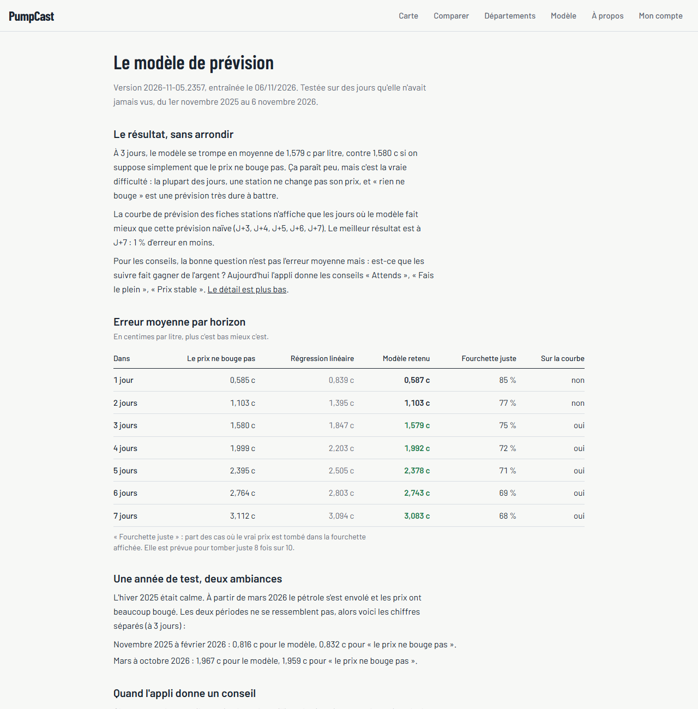

# PumpCast

[](https://github.com/ManuelDavid69/PumpCast/actions/workflows/ci.yml)

Appli web qui prévoit l'évolution du prix des carburants station par station, pour répondre à une question simple : je fais le plein maintenant ou j'attends quelques jours ?

**En ligne : https://pump-cast.vercel.app**

Les applis de prix (Essence&Co, Carbu...) montrent le prix du jour. PumpCast regarde aussi l'historique de la station, le cours du pétrole, les vacances et les jours fériés pour estimer où va le prix sur les 7 prochains jours, et dit franchement quand il n'en sait rien.

Projet perso, fait en 4e année d'école d'ingénieur (CPE Lyon) pour apprendre Go, GraphQL, MongoDB, Redis, Next.js et le machine learning avec scikit-learn.

> L'API est hébergée gratuitement et s'endort après 15 minutes sans visite : la première page peut mettre une minute à charger.



## Ce que fait l'appli

- **Carte des stations** autour de soi ou d'une ville, triées par prix ou par distance, pour chaque carburant. Les ruptures de stock du flux officiel sont affichées.
- **Fiche station** : prix actuels, historique, prévision sur les jours suivants avec une fourchette, et un conseil (« Attends », « Fais le plein », « Prix stable ») avec ses raisons.
- **Comparaison** de plusieurs stations sur un même graphique.
- **Départements** : carte de France des prix moyens, statistiques et évolution sur 30 jours.
- **Page Modèle** : les scores du modèle face à une prévision naïve, sans arrondir.
- **Compte** : stations favorites et alertes par email (prix sous un seuil, baisse ou hausse prévue).

| Fiche station | Sur mobile |
|---|---|
|  |  |
| **Comparaison** | **Départements** |
|  |  |

## Comment c'est construit



- **`api/`** (Go) : l'API GraphQL (`cmd/server`), l'ingestion du flux (`cmd/ingest`), l'import des archives (`cmd/importhistory`) et l'envoi des alertes (`cmd/alerts`).
- **`ml/`** (Python) : récupération des données externes, features, entraînement, évaluation et prévisions du jour. Plus le notebook d'exploration.
- **`web/`** (Next.js, TypeScript, Tailwind) : le site.

Le modèle ne tourne pas en continu : il est entraîné une fois par semaine et calcule les prévisions une fois par jour, qui sont écrites dans MongoDB. L'API Go les lit comme n'importe quelle autre donnée. Pas de serveur Python à héberger, et c'est comme ça que fonctionnent beaucoup de systèmes de prévision en entreprise.

## Le modèle, honnêtement

C'est la partie qui m'a demandé le plus de temps, et la plus importante à ne pas enjoliver.

Le modèle prévoit la variation du prix de chaque station à 1, 2... 7 jours. C'est un gradient boosting de scikit-learn (`HistGradientBoostingRegressor`), un modèle par horizon, entraîné sur toutes les stations d'Auvergne-Rhône-Alpes de 2023 à octobre 2025.

La référence à battre est la prévision naïve « le prix ne bouge pas ». Elle est très dure à battre : la plupart des jours, une station ne change pas son prix. Erreur moyenne en centimes par litre, sur un an de test que le modèle n'avait jamais vu (novembre 2025 à novembre 2026) :

| Dans | Le prix ne bouge pas | Régression linéaire | Gradient boosting |
|---|---|---|---|
| 1 jour | 0,585 c | 0,839 c | 0,587 c |
| 3 jours | 1,580 c | 1,847 c | 1,579 c |
| 5 jours | 2,395 c | 2,505 c | 2,378 c |
| 7 jours | 3,112 c | 3,094 c | 3,083 c |

Autrement dit, le modèle fait à peine mieux que la prévision naïve : égalité à 1 et 2 jours, environ 1 % d'erreur en moins à 7 jours. C'est un résultat modeste, et je préfère l'afficher tel quel.



Ce que j'ai mis en place pour que ces chiffres soient fiables :

- **Découpage dans le temps uniquement.** Réglages sur mai à octobre 2025 (validation), résultat final sur novembre 2025 à aujourd'hui (test). Un découpage au hasard aurait laissé le modèle « voir le futur » et donné de faux bons scores.
- **Pas de fuite d'information.** Le cours du Brent est publié par la FRED avec environ une semaine de retard : le modèle n'utilise que ce qui était réellement connu le jour de la prévision.
- **Des fourchettes calibrées.** Deux modèles quantiles (10 % et 90 %) recalés par calibration conformale. Le vrai prix tombe dans la fourchette affichée dans 68 à 85 % des cas selon l'horizon.

Deux règles décident de ce qui est affiché :

1. **La courbe de prévision** des fiches stations ne montre que les horizons où le modèle bat la prévision naïve sur le test (aujourd'hui de J+3 à J+7). Un prix prévu moins juste que « rien ne bouge » serait trompeur.
2. **Les conseils** sont jugés sur ce qu'ils font gagner, pas sur l'erreur moyenne. Chaque type de conseil est rejoué sur le passé : on regarde s'il était juste et combien il aurait fait économiser. Il n'est activé que s'il passe la validation (au moins 30 cas, 60 % de conseils justes, gain moyen positif) puis est confirmé sur le test (10 cas, 50 %, gain positif).

Sur le test, les conseils activés donnent :

| Conseil | Donné | Juste | Gain moyen |
|---|---|---|---|
| Attends | 104 fois | 78 % | +4,7 c par litre |
| Fais le plein | 310 fois | 81 % | +6,4 c par litre |
| Prix stable | presque tout le reste | 73 % | - |

Les conseils « Attends » et « Fais le plein » sont donc rares (quelques centaines sur 400 000 jours-stations), mais quand le modèle en donne un, il a raison 8 fois sur 10. Le reste du temps, l'appli dit que le prix devrait rester stable, ce qui est le cas le plus fréquent.

Les variables qui comptent le plus (mesuré par permutation importance) : la tendance nationale des prix sur les derniers jours, la fréquence à laquelle la station change ses prix, le jour de la semaine et l'écart avec la moyenne du département. Les explications affichées sur les fiches (« cette station est 10 c au-dessus de la moyenne du département ») sont construites à partir de ces variables.

## Quelques choix techniques

**Pourquoi GraphQL.** Chaque page a besoin de données très différentes : prix actuels et conseil sur l'accueil, historique complet et prévision sur la fiche station, plusieurs courbes pour la comparaison. Avec GraphQL, chaque page demande exactement les champs qu'elle affiche, en une requête. Le schéma est écrit à la main et gqlgen génère le code Go (`api/graph/*.graphqls`).

**Le problème N+1.** Afficher 20 stations avec leur historique ferait 20 requêtes MongoDB. Des dataloaders regroupent ces requêtes en une seule, et un test compte les requêtes envoyées à MongoDB pour le vérifier.

**MongoDB.**
- Les prix sont dans une collection time series, qui compresse très bien les données horodatées : 5,7 millions de relevés tiennent dans 30 Mo sur le disque.
- Un index 2dsphere sert à trouver les stations proches.
- Des aggregation pipelines calculent les statistiques par département.

**Redis.**
- Il garde les prix actuels de toute la France, les statistiques par département et les compteurs du rate limiting (120 requêtes par minute et par IP).
- L'offre gratuite d'Upstash est limitée à 500 000 commandes par mois. Ma première version de l'ingestion en faisait 9 000 par passage, soit 13 fois la limite en tournant toutes les heures. Les prix actuels sont maintenant rangés dans un seul hash, remplacé d'un coup à chaque ingestion : 4 commandes au lieu de 9 000.

**Next.js.**
- Les fiches stations, la comparaison et les départements sont rendus côté serveur : la page arrive déjà remplie, rapide à afficher et lisible par Google.
- Apollo Client ne sert qu'à la carte de l'accueil, qui relance des requêtes quand on change de ville ou de carburant.
- Les courbes sont en escalier : un prix ne bouge pas entre deux changements, une courbe lissée inventerait des prix qui n'ont jamais existé.

**Sécurité des comptes.**
- Mots de passe hachés avec bcrypt.
- Le jeton JWT est gardé dans un cookie httpOnly, que le JavaScript de la page ne peut pas lire, avec une vérification d'origine contre le CSRF.
- La connexion renvoie le même message et met le même temps que l'email existe ou non.
- Les erreurs internes ne sont jamais renvoyées au client.
- On peut supprimer son compte avec toutes ses données.

## Les compromis

**Le périmètre géographique.** L'hébergement gratuit de MongoDB est limité à 512 Mo. Les prix actuels sont gardés pour toute la France (dans Redis), mais l'historique jour par jour et les prévisions ne le sont que pour Auvergne-Rhône-Alpes, soit environ 2 000 stations. La liste des départements est une variable de config (`HISTORY_DEPARTMENTS`). Aujourd'hui la base fait 66 Mo sur le disque, il y a donc de la marge pour l'élargir.

**Tout en gratuit.**

| Service | Rôle | Limite qui compte |
|---|---|---|
| Vercel | Front | Usage non commercial |
| Render | API Go | S'endort après 15 min sans visite |
| MongoDB Atlas | Base de données | 512 Mo, 100 opérations par seconde |
| Upstash | Redis | 500 000 commandes par mois |
| GitHub Actions | Ingestion, prévisions, entraînement | Gratuit pour un dépôt public |
| Brevo | Emails d'alerte | 300 emails par jour |

Le pas à pas du déploiement est dans [docs/deploiement.md](docs/deploiement.md).

**Une seule source de prix.** Le flux officiel ne donne pas l'enseigne des stations (Total, Leclerc...). Plutôt que de l'inventer, l'appli affiche l'adresse et la ville.

**Ce qui m'a posé problème.**
- MongoDB 8 ne démarre pas sur le noyau Linux des runners GitHub (bug connu de son allocateur mémoire). La CI teste donc en MongoDB 7.0, alors que le local et Atlas tournent en 8.0.
- Les serveurs de Vercel sont en UTC : les heures de mise à jour s'affichaient avec une heure de décalage avant que je force le fuseau de Paris.

## Lancer en local

Prérequis : Docker, Go 1.27+ et Node.js.

```bash
cp .env.example .env
docker compose up -d
```

Ça démarre MongoDB (port 27017) et Redis (port 6379).

Récupérer les prix du jour (à relancer quand on veut, ça ne crée pas de doublons) :

```bash
cd api
go run ./cmd/ingest
```

Importer l'historique depuis les archives annuelles (environ 2 min, les zips sont gardés dans `data/archives/`) :

```bash
go run ./cmd/importhistory -from 2023 -to 2026
```

Les archives ne donnent que les changements de prix. L'import reconstruit un prix par jour (le dernier prix connu), arrête de reporter un prix resté 30 jours sans mise à jour et saute les jours de rupture. 2022 n'est pas importée par défaut : la remise carburant de l'État d'avril à décembre crée des sauts de prix artificiels.

Récupérer les données externes, entraîner le modèle (une quinzaine de minutes) puis calculer les prévisions du jour :

```bash
docker compose --profile ml run --rm ml
docker compose --profile ml run --rm ml python -m pumpcast_ml.train
docker compose --profile ml run --rm ml python -m pumpcast_ml.predict
```

Le notebook d'exploration (Jupyter Lab sur http://localhost:8888) :

```bash
docker compose --profile ml up notebook
```

L'API, sur http://localhost:8080/graphql (avec une page pour tester les requêtes sur `/playground`) :

```bash
cd api
go run ./cmd/server
```

Exemple de requête, les 5 stations les moins chères en gazole autour de Villeurbanne avec leur historique :

```graphql
{
  stationsNear(lat: 45.7712, lng: 4.8835, radiusKm: 5, fuel: GAZOLE, sort: PRICE, limit: 5) {
    address
    city
    distanceKm
    currentPrices { fuel price outOfStock }
    priceHistory(fuel: GAZOLE, days: 30) { date price }
  }
}
```

Le front, sur http://localhost:3000 :

```bash
cd web
cp .env.example .env.local
npm install
npm run dev
```

Les alertes (en local, `EMAIL_PROVIDER=log` affiche les emails dans la console au lieu de les envoyer) :

```bash
cd api
go run ./cmd/alerts
```

## Tests

Les tests d'intégration Go ont besoin du MongoDB et du Redis locaux (ils sont ignorés sinon). La CI lance tout à chaque push.

```bash
cd api && MONGO_TEST_URI=mongodb://localhost:27017 REDIS_TEST_URL=redis://localhost:6379/15 go test ./...
docker compose --profile ml run --rm --no-deps ml python -m pytest -q
cd web && npm test
```

## Sources des données

Toutes sous licence ouverte et gratuites, sans scraping :

- Prix des carburants, flux instantané et archives annuelles : prix-carburants.gouv.fr / data.economie.gouv.fr, Licence Ouverte 2.0
- Prix du Brent : FRED, Federal Reserve Bank of St. Louis (série DCOILBRENTEU)
- Taux de change EUR/USD : Banque centrale européenne
- Jours fériés : calendrier.api.gouv.fr
- Vacances scolaires : data.education.gouv.fr
- Recherche de ville : Géoplateforme de l'IGN
- Fonds de carte : OpenStreetMap
